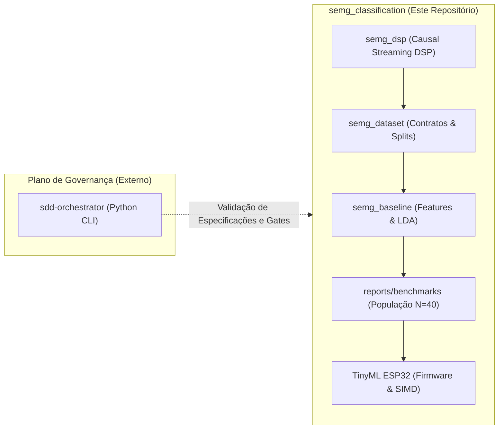

# `semg_classification`
### Causal Streaming DSP, Neuromuscular Decoding & TinyML for ESP32

[](https://www.python.org/downloads/)
[-success.svg)](file:///home/allisson/Projects/agents_emg/tests)
[](https://github.com/astral-sh/ruff)
[](file:///home/allisson/Projects/agents_emg/specs)
[](LICENSE)

An agentically-engineered, mathematically validated surface electromyography (**sEMG**) signal processing and neuromuscular gesture recognition framework designed for **ultra-low-latency real-time prosthetic control** and **TinyML edge deployment on ESP32 microcontrollers**.

---

## 1. Arquitetura e Desacoplamento do Orquestrador

> [!IMPORTANT]
> **Desacoplamento Arquitetural**:
> O controle de ciclo de vida, máquinas de estado de especificação e verificação determinística de agentes anteriormente integrados a este repositório foram formalmente desacoplados e migrados para o repositório independente [**`sdd-orchestrator`**](https://github.com/AllissonChervenski/sdd-orchestrator).
>
> Este repositório (**`semg_classification`**) é dedicado exclusivamente à engenharia de sinal biomédico, extração de características em ponto fixo, modelagem estatística linear, benchmarks populacionais e firmware TinyML.



---

## 2. Pipeline Atualizado de Processamento e Inferência

O pipeline de ponta a ponta opera com **causalidade temporal estrita**, garantindo invariância matemática frente ao tamanho dos chunks de aquisição do ADC e resposta em tempo real muito abaixo do limiar perceptivo humano de $100\text{ ms}$:

```
┌─────────────────────────────────┐
│ Eletrodos sEMG Analógicos (2kHz)│
└────────────────┬────────────────┘
                 ▼
┌─────────────────────────────────┐
│ ADC de Entrada (16-bit / 8-bit) │ ──► [ADS1298 / ADC interno em int16 ou int8]
└────────────────┬────────────────┘
                 ▼
┌─────────────────────────────────┐
│ CausalSosFilter (DF2T Biquad)   │ ──► Butterworth 4ª ordem (20–450 Hz) + Notch 50/60 Hz
└────────────────┬────────────────┘
                 ▼
┌─────────────────────────────────┐
│ StatefulWindowBuffer            │ ──► Janela W = 200 ms (400 amostras), Stride S = 50 ms
└────────────────┬────────────────┘
                 ▼
┌─────────────────────────────────┐
│ Extração de Features TD (SIMD)  │ ──► Hudgins: MAV, RMS, WL, ZC (10µV), SSC (10µV)
└────────────────┬────────────────┘
                 ▼
┌─────────────────────────────────┐
│ Canonical Micro-LDA / TinyML    │ ──► y = W * x + b (200 bytes de coeficientes em Cache L1)
└────────────────┬────────────────┘
                 ▼
┌─────────────────────────────────┐
│ Decisão e Controle de Motores   │ ──► Latência < 0.05 ms (Acionamento prótese em < 55 ms)
└─────────────────────────────────┘
```

---

## 3. Estado Atual: O Que Já Foi Implementado

Todas as funcionalidades foram desenvolvidas sob contratos formais em [`specs/`](specs/) e validadas por **361 testes unitários determinísticos (100% de aprovação)**:

### Feature 001: Core Architecture & Governance Gate
* Estrutura de pacotes modular, tipagem estrita com `mypy` e isolamento de dependências.
* Gate de governança e verificação de AST para bloquear bibliotecas proibidas fora do host de treino.

### Feature 002: Causal Streaming DSP Pipeline ([`semg_dsp`](semg_dsp/))
* **`ChunkData`**: Contêiner imutável de amostras multicanal com verificação de tipo `float32` e hash SHA-256.
* **`CausalSosFilter`**: Cascata de biquads em Forma Direta II Transposta (DF2T) com preservação de estado interno entre chunks arbitrários (invariância a chunks de 1 a 10.000 amostras).
* **`StatefulWindowBuffer`**: Buffer circular causal com janela deslizante configurável e políticas de finalização (`drop`, `pad`).
* **`SyntheticSampleSource`**: Gerador analítico com continuidade de fase estrita (senoides, impulsos, degraus, tons múltiplos e saturação física).

### Feature 003: Dataset Contracts, Provenance & Splitting ([`semg_dataset`](semg_dataset/))
* Intake audit completo e ingestão do banco **NinaPro DB2** (40 sujeitos, 12 canais, 2000 Hz, 50 classes).
* Splitters determinísticos com controles negativos de vazamento de dados (**LOTO intra-sujeito** e **5-Fold Cross-Subject**).
* `FrozenViewManager` e manifestos de integridade criptográfica com hashes SHA-256 por arquivo.

### Feature 004: Baseline Classification & Confounding Audit ([`semg_baseline`](semg_baseline/))
* Extrator analítico de características no domínio do tempo (conjunto Hudgins: MAV, RMS, WL, ZC, SSC) com banda morta de ruído de $10\text{ µV}$.
* Calibrador e escalonador Z-Score ajustado estritamente sobre os dados de treino (`train-only`).
* Classificador **Canonical LDA Regularizado** ($\alpha = 10^{-3}$) com prior uniforme.
* Auditoria de variáveis de confusão (exercícios E1, E2, E3) e controle de permutação de rótulos (`ShuffledLabelNegativeControl`).

### Benchmarks Populacionais Cross-Dataset: NinaPro DB2 vs. Ozdemir et al. ($N = 40$)
* Ingestão auditada do dataset [Ozdemir et al.](data/manifests/ozdemir/) ($N=40$ sujeitos, 4 canais, 10 classes, $1.280.000$ amostras por sujeito).
* Cruzamento populacional exaustivo de **5 resoluções de quantização** (`float32`, `float16`, `int32`, `int16`, `int8`) $\times$ **redução de canais** (12 a 1 canal no NinaPro, 4 a 1 canal no Ozdemir):
  * **Lei da Invariância em 16-bit**: `int16` atinge acurácia idêntica ao `float32` ($\Delta < 0.01\%$) em ambos os datasets, cortando a taxa de barramento pela metade (**-50% de dados**).
  * **Fronteira de Pareto & FoM**: Manter 4 canais em 8 bits (`int8` @ 4ch = **70.31%**, 4 B/amostra) é **+10.44% superior** a reduzir para 2 canais em 32 bits (`float32` @ 2ch = **59.87%**, 8 B/amostra).
  * Relatório técnico completo documentado em [`reports/benchmarks/cross_dataset_quantization_and_channel_reduction_comparison.md`](reports/benchmarks/cross_dataset_quantization_and_channel_reduction_comparison.md).

---

## 4. Próximas Features (Roadmap)

| Feature | Nome / Escopo | Objetivo Principal | Alvo de Hardware |
| :---: | :--- | :--- | :---: |
| **`feat-005`** | **ESP32-S3 TinyML Micro-LDA** | Firmware C/C++ nativo (ESP-IDF) com double-buffer DMA, aceleração SIMD vetorial (PIE) para MAV/WL em inteiros e inferência em $< 0.05\text{ ms}$. | ESP32-S3 (Xtensa LX7) |
| **`feat-006`** | **BLE Low Energy Telemetry** | Protocolo de streaming sem fio contínuo de 4 canais em `int8` ($8.0\text{ kB/s}$) com recuperação de pacotes e empacotamento circular. | ESP32 / NRF52840 |
| **`feat-007`** | **Compact 1D-CNN Micro-Baselines** | Redes neurais convolucionais 1D quantizadas em INT8 (TFLite Micro) para preensões dinâmicas com footprint de SRAM $< 20\text{ kB}$. | ESP32-S3 / Cortex-M4F |
| **`feat-008`** | **Adaptive Calibration & Drift Compensation** | Algoritmo online de recalibração não supervisionada contra fadiga muscular e deslocamento físico de eletrodos. | Firmware Embarcado |

---

## 5. Hierarquia e Organização de Diretórios

```
semg_classification/
├── .env.example             # Modelo seguro de variáveis de ambiente (sem credenciais)
├── .gitignore               # Ignora artefatos de build, caches, logs e .env
├── pyproject.toml           # Configuração de build, metadados do pacote e linters
├── AGENTS.md                # Diretrizes operacionais desacopladas para agentes
├── README.md                # Documentação técnica central
│
├── semg_dsp/                # Pacote de Processamento Causal de Sinais em Streaming
│   ├── filter.py            # CausalSosFilter (Biquads DF2T)
│   ├── window.py            # StatefulWindowBuffer circular
│   ├── source.py            # Fontes de sinal e geradores analíticos contínuos
│   └── pipeline.py          # Coordenador de streaming de sinal
│
├── semg_dataset/            # Pacote de Contratos, Proveniência e Particionamento
│   ├── contract.py          # Esquemas de gravação, metadados e canais
│   ├── loader.py            # Ingestão de datasets (NinaPro DB2, Ozdemir)
│   ├── splits.py            # Splitters LOTO e Cross-Subject sem vazamento
│   ├── manifest.py          # Geração de inventários e provas de integridade
│   └── provenance.py        # Validação criptográfica de arquivos brutos
│
├── semg_baseline/           # Pacote de Extração de Features, Modelos e Inferência
│   ├── features.py          # Extrator TD de Hudgins (MAV, RMS, WL, ZC, SSC)
│   ├── thresholds.py        # Calibração de bandas mortas de ruído
│   ├── scaling.py           # Z-Score Scaler estritamente ajustado no treino
│   ├── lda.py               # Canonical Linear Discriminant Analysis com shrinkage
│   ├── predictor.py         # Preditor neutro puramente numérico (zero dependências)
│   ├── runner.py            # Executores de treino, validação cruzada e LOTO
│   └── governance.py        # Auditoria de dependências e gates de conformidade
│
├── specs/                   # Especificações Vivas do Ciclo SDD (SpecKit)
│   ├── 002-dsp-streaming-pipeline/
│   ├── 003-dataset-contract-and-splits/
│   └── 004-baseline-training-and-evaluation/
│
├── scripts/                 # Ferramentas de Linha de Comando, Auditoria e Benchmark
│   ├── audit_ozdemir_dataset.py
│   ├── benchmark_quantization_and_channels.py
│   ├── benchmark_ozdemir_quantization_and_channels.py
│   └── validate_feature_004.py
│
├── data/                    # Dados e Metadados
│   ├── manifests/           # Inventários e sumários de cobertura de sujeitos
│   └── raw/                 # Armazenamento local de datasets brutos (.gitignore)
│
├── reports/                 # Relatórios Estruturados de Verificação e Benchmarks
│   ├── benchmarks/          # Relatórios e checkpoints populacionais (N=40)
│   ├── feature_002_acceptance/
│   ├── feature_003_acceptance/
│   └── feature_004_baseline/
│
├── docs/                    # Documentação e Engenharia de Software
│   ├── adr/                 # Architectural Decision Records formais
│   └── reports/             # Relatórios técnicos científicos
│
└── tests/                   # 361 Testes Automatizados (Pytest)
    ├── fixtures/            # Golden references e oráculos analíticos independentes
    ├── test_dsp_*.py        # Testes de streaming, filtros e invariância
    ├── test_dataset_*.py    # Testes de contratos e partição de dados
    └── test_baseline_*.py   # Testes de modelagem, quantização e métricas
```

---

## 6. Governança de Segurança e Dados Sensíveis

> [!CAUTION]
> **Política de Tolerância Zero para Dados Sensíveis**:
> - **Nenhuma chave de API, senha, token de autenticação ou credencial privada** pode ser commitada no código-fonte ou em arquivos de teste.
> - O arquivo `.gitignore` bloqueia explicitamente qualquer variante de `.env`, `.env.local` e arquivos de credenciais.
> - Parâmetros configuráveis devem ser definidos exclusivamente através de variáveis de ambiente do sistema operacional ou via cópia local de [`.env.example`](.env.example):
>   ```bash
>   cp .env.example .env
>   ```

---

## 7. Instalação e Execução

### Pré-requisitos
* Python 3.10 ou superior.
* Gerenciador de pacotes `pip` ou [`uv`](https://github.com/astral-sh/uv).

### Instalação em Modo Editável
```bash
# Clonar o repositório
git clone https://github.com/AllissonChervenski/semg_classification.git
cd semg_classification

# Criar ambiente virtual
python -m venv .venv
source .venv/bin/activate

# Instalar dependências de produção e desenvolvimento
pip install -e ".[dev,baseline]"
```

### Execução da Suíte de Testes
```bash
# Executar todos os 361 testes unitários determinísticos
python -m pytest -q

# Verificação estática de tipos e estilo
python -m ruff check semg_dsp semg_dataset semg_baseline tests scripts
python -m mypy
```

### Executar os Benchmarks de Quantização e Redução de Canais
```bash
# Executar benchmark populacional do dataset Ozdemir et al. (40 sujeitos)
python scripts/benchmark_ozdemir_quantization_and_channels.py --all-subjects --workers 2 --save

# Executar benchmark populacional do dataset NinaPro DB2 (40 sujeitos)
python scripts/benchmark_quantization_and_channels.py --all-subjects --workers 2 --save
```

---

## 8. Licença

Este projeto é disponibilizado sob a licença [MIT](LICENSE).
