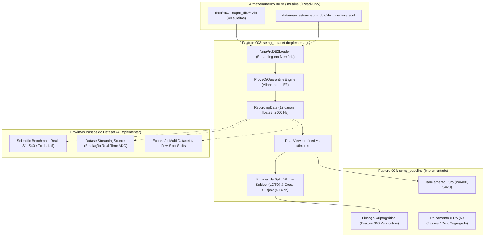
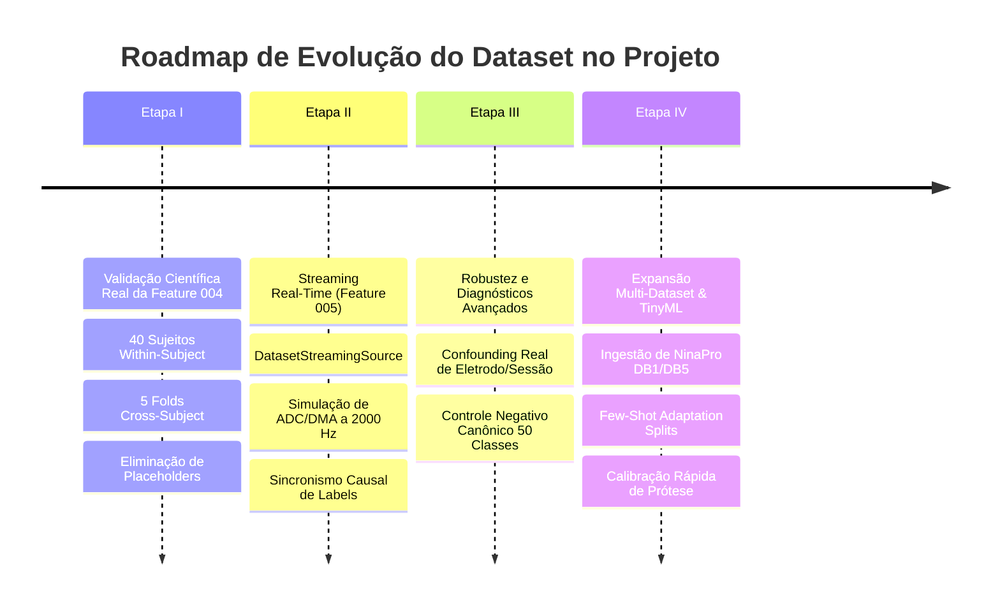

# Relatório Técnico — Dataset NinaPro DB2: Implementações Realizadas e Roadmap Futuro

**Projeto**: `agents_emg` — Causal Streaming DSP & Gesture Recognition Pipeline  
**Foco**: Especificação, Contratos, Integridade e Planejamento do Dataset  
**Data**: 2026-10-13  
**Status**: Consolidado e Alinhado com a Governança SDD  

---

## 1. Visão Geral e Contexto do Dataset NinaPro DB2

O NinaPro Database 2 (Non-Invasive Adaptive Prosthetics, Database 2) é o dataset científico de referência adotado oficialmente pelo projeto para validação de algoritmos de processamento causal de sinais sEMG e classificação de padrões gestuais da mão e punho.



### Características do Dataset NinaPro DB2
- **Coorte**: 40 participantes intactos (28 homens, 12 mulheres; 34 destros, 6 canhotos; idades entre 24 e 44 anos).
- **Aparelhagem de Aquisição**: 12 eletrodos ativos sem fio Delsys Trigno Wireless sEMG com amostragem fixa em **2000 Hz**:
  - Eletrodos 1 a 8: distribuídos equidistantes ao redor do antebraço na altura do terço proximal;
  - Eletrodos 9 e 10: posicionados no flexor radial do carpo e no extensor radial longo do carpo;
  - Eletrodos 11 e 12: posicionados no bíceps braquial e tríceps braquial.
- **Taxonomia de Exercícios e Vocabulário de Gestos**:
  - **Exercício 1 (E1)**: 17 movimentos básicos de dedos individuais e configurações do punho (rótulos globais 1 a 17);
  - **Exercício 2 (E2)**: 23 preensões funcionais manuais e posturas estáticas dos dedos (rótulos globais 18 a 40);
  - **Exercício 3 (E3)**: 9 padrões de força dinâmicos e preensões complexas (rótulos globais 41 a 49);
  - **Classe de Repouso (REST)**: rótulo canônico `0`, presente em todos os exercícios.
  - **Total**: **50 classes canônicas** ($0 = \text{REST}$, $1..49 = \text{gestos ativos}$).
- **Protocolo de Repetições**: Cada gesto é repetido 6 vezes por exercício, com 5 segundos de contração ativa intercalados por 3 segundos de repouso muscular.
- **Arquivos Físicos**: 120 gravações MATLAB `.mat` contidas em 40 arquivos ZIP originais (`DB2_s1.zip` a `DB2_s40.zip`) totalizando ~13 GB.

---

## 2. O Que Foi Implementado em Relação ao Dataset

Todas as implementações do dataset foram governadas pelas Features 003 e 004, com cobertura completa por testes unitários e de integração, portões determinísticos e conformidade constitucional.

### 2.1 Ingestão Imutável e Integridade da Armazenagem Bruta
- **Regra de Imutabilidade (*Read-Only*)**: O diretório `data/raw/ninapro_db2/` é categoricamente tratado como somente-leitura. Nenhuma execução cria, altera ou descompacta arquivos dentro dessa pasta.
- **Leitura sob Demanda em Memória**: O sistema extrai e analisa os arquivos MATLAB `.mat` diretamente do fluxo binário compactado dos arquivos `.zip` em memória RAM (via `zipfile` e `scipy.io.loadmat`), sem gerar arquivos intermediários descompactados no disco rígido.
- **Inventário e Verificação Criptográfica**: Todos os 120 arquivos ZIP possuem seus checksums SHA-256 e tamanhos em bytes registrados em `data/manifests/ninapro_db2/file_inventory.jsonl` e validados pelo manifesto `intake_manifest.json`.

### 2.2 Entidades e Contrato Canônico de Dados (`semg_dataset/contract.py`)
- **`RecordingData`**: Estrutura central e imutável que encapsula uma gravação completa:
  - `subject_id`: identificador normalizado do sujeito (`"S1"` a `"S40"`);
  - `exercise_id`: identificador do exercício (`"E1"`, `"E2"`, `"E3"`);
  - `emg`: matriz multicanal com shape `(N, 12)` e tipo estritamente forçado para `numpy.float32`, livre de valores `NaN` ou `Inf`;
  - `sampling_rate_hz`: float positivo fixado nominalmente em `2000.0`;
  - `stimulus` e `repetition`: arrays de estímulo visual planejado e repetição correspondente;
  - `restimulus` e `rerepetition`: arrays refinados por ativação real baseados no limiar do sinal sEMG;
  - `alignment`: registro do método de alinhamento temporal aplicado e evidências numéricas;
  - `provenance`: dicionário com DOI, licenciamento, versão do dataset e metadados de aquisição.

### 2.3 Visões Duplas de Rótulos de Ground-Truth (`GroundTruthView`)
O NinaPro DB2 fornece dois paradigmas de anotação de gestos:
1. **Visão Refinada (`view="refined"`)**: Rótulos derivados do início real do esforço muscular (`restimulus` e `rerepetition`). É a visão autoritativa para aprendizado de máquina supervisionado de precisão.
2. **Visão de Estímulo (`view="stimulus"`)**: Rótulos derivados da indicação na tela apresentada ao usuário (`stimulus` e `repetition`).
- **Bloqueio Determinístico de Mistura Cruzada**: O contrato proíbe expressamente emparelhar `stimulus` com `rerepetition` ou `restimulus` com `repetition`. Qualquer tentativa gera falha imediata por construção de tipo.
- **Hash Canônico de Visão (`view_hash`)**: Cada visão calcula um hash determinístico SHA-256 sobre a combinação dos sinais e rótulos, garantindo proveniência imutável de cada fatia de dados.

### 2.4 Resolução Matemática de Desalinhamento: Motor PROVE-OR-QUARANTINE (`semg_dataset/alignment.py`)
Durante a auditoria sistemática de intake dos 120 arquivos MATLAB originais, foram encontradas divergências de tamanho de vetor no Exercício 3 em 18 gravações (com destaque para `S12_E3_A1.mat`, que continha uma discrepância de 272 amostras / $\approx 136\,\text{ms}$ entre o sinal EMG e os rótulos de ativação).

- **Investigação da Causa Raiz**: Provou-se que o sinal EMG e os sinais de estímulo/repetição iniciam perfeitamente sincronizados em $t=0$ no disparo do trigger. O truncamento nos vetores `restimulus`/`rerepetition` decorreu exclusivamente da filtragem passa-baixa offline aplicada pelos autores originais do NinaPro no encerramento da gravação.
- **Política `anchor_start_truncate_tail`**: Como a âncora inicial em $t=0$ é comprovadamente síncrona, truncar o excesso na cauda final do sinal EMG alinha perfeitamente as séries sem distorção de fase.
- **Invariante PROVE-OR-QUARANTINE**: Truncamento automático cego via `min()`, preenchimento com zeros (*zero-padding*) ou interpolações foram terminantemente proibidos. O motor exige prova matemática formal de âncora inicial. Caso uma gravação não passe no teste de prova, ela é direcionada para a quarentena (`QUARANTINE`).

### 2.5 Protocolos de Particionamento Livres de Vazamento (*Leakage-Free Splits*) (`semg_dataset/splits.py`)
Dois motores determinísticos de divisão de dados foram implementados com garantias matemáticas de conjuntos disjuntos:

#### 1. Protocolo Within-Subject (LOTO — Leave-One-Trial-Out)
- Projetado para avaliar a precisão de um modelo calibrado especificamente para um usuário.
- Para cada participante, as 6 repetições de cada gesto são divididas de forma estritamente disjunta:
  - **Treino**: 4 repetições (ex.: repetições 1, 3, 4, 6);
  - **Validação**: 1 repetição (ex.: repetição 2, para seleção de hiperparâmetros);
  - **Teste**: 1 repetição (ex.: repetição 5, congelada para avaliação final única).
- A função `validate_within_subject_leakage()` bloqueia qualquer sobreposição:
  $$\text{repetições\_treino} \cap \text{repetições\_teste} = \emptyset$$

#### 2. Protocolo Cross-Subject (Benchmark de 5 Folds Rotativos)
- Projetado para avaliar a generalização do modelo entre diferentes usuários (variabilidade inter-sujeito).
- Os 40 participantes são distribuídos em 5 folds determinísticos:
  - **Treino**: 24 sujeitos (60% da coorte);
  - **Validação**: 8 sujeitos (20% da coorte);
  - **Teste**: 8 sujeitos (20% da coorte).
- A função `validate_cross_subject_leakage()` garante disjunção absoluta de sujeitos:
  $$\text{sujeitos\_treino} \cap \text{sujeitos\_val} = \emptyset \quad \land \quad \text{sujeitos\_treino} \cap \text{sujeitos\_teste} = \emptyset \quad \land \quad \text{sujeitos\_val} \cap \text{sujeitos\_teste} = \emptyset$$

#### Hashes Autoritativos Congelados na Feature 003
O pacote de aceite da Feature 003 ([`reports/feature_003_acceptance/manifest.sha256`](file:///home/allisson/Projects/agents_emg/reports/feature_003_acceptance/manifest.sha256)) congelou os hashes definitivos de cada artefato de partição:
- `raw/alignment_audit.jsonl`: `434ba6578dca1630764cdd4972d20b2aa37b1b010779dab709b0df64f4e94a83`
- `raw/within_subject_audit.json`: `8192aa13cfe64ef80af92411d37a9914dc7184e169a976850515f25f82c9e02d`
- `raw/cross_subject_audit.json`: `cbd9addbf26a289ed89e6922cee509cb896a66bc0c9687705996814f1a781d5a`
- `raw/view_audit.json`: `ff722e385efbba6e74ac59b1e8252e486997a500d7b5916e1a02f2b1ea7dae45`

### 2.6 Carregador em Memória (`semg_dataset/loader.py`)
A classe `NinaProDB2Loader` unificou todo o ciclo de vida:
- Varrimento de arquivos com validação de expressões regulares (`^DB2_s(\d+)\.zip$`);
- Ordenação natural dos sujeitos (`S1` a `S40`);
- Carregamento de gravações individuais via `load_recording(subject_id, exercise_id, view="refined")`;
- Aplicação automática e auditada do motor `ProveOrQuarantineEngine`.

### 2.7 Integração do Dataset na Feature 004 (`semg_baseline`)
- **Verificação de Contratos Congelados**: `verify_feature_003_frozen_contracts()` valida que nenhum arquivo de aceitação ou manifesto da Feature 003 sofreu modificações ou adulteração antes de qualquer treino.
- **Rastreamento de Linhagem Científica (`ScientificLineage`)**: Toda execução de treino e teste sela no manifesto do modelo os hashes exatos dos arquivos brutos, do alinhamento e dos splits.
- **Janelamento Puro de Contração**: Extração de janelas contínuas de $W = 400$ amostras ($200\,\text{ms}$) e passo $S = 20$ amostras ($10\,\text{ms}$) exclusivamente sobre trechos estáveis de contração ou repouso, sem cruzar fronteiras de transição.
- **Estimação do Limiar Adaptativo de Ruído**: Cálculo do ruído de repouso por canal $\sigma_{\text{REST}, c}$ diretamente a partir das janelas de repouso do dataset para calibrar os limiares de ZC e SSC.

---

## 3. O Que Será Implementado em Relação ao Dataset

Embora a engenharia de dados (contrato, leitor, alinhamento e splits) esteja 100% implementada e testada, a evolução do repositório exige novas etapas específicas sobre a utilização e expansão do dataset:



---

### 3.1 Etapa I — Benchmark Científico Real da Feature 004 (Transição do Sintético para o Real)

Atualmente, o script `scripts/validate_feature_004.py` executou com sucesso a verificação estrutural e funcional da arquitetura de ponta a ponta, porém utilizando fixtures sintéticos (`SYNTH_S1` com 5 classes e um cohort sintético de 4 classes) e placeholders de hashes (`"a"*64`, `"b"*64`) na camada demonstrativa.

A próxima etapa obrigatória sobre o dataset consiste em:

#### 1. Eliminação Estrita de Placeholders e Hardening de Proveniência
- O script de validação rejeitará qualquer execução que utilize strings arbitrárias de hashes.
- O hash de visualização (`dataset_view_hash`) será calculado dinamicamente através de `compute_dataset_view_hash` consumindo diretamente os objetos `RecordingData` do NinaPro DB2 real.
- O hash de split (`split_manifest_hash`) será resolvido diretamente a partir dos arquivos autoritativos congelados da Feature 003 (`within_subject_audit.json` e `cross_subject_audit.json`).
- Falha imediata (*fail-closed*) se os hashes calculados divergirem dos valores em `reports/feature_003_acceptance/manifest.sha256`.

#### 2. Execução Completa do Benchmark Within-Subject Real (S1 a S40)
- Executar o protocolo LOTO para todos os 40 sujeitos do NinaPro DB2:
  - 4 rotações de validação interna por sujeito para selecionar o multiplicador $R$;
  - 1 avaliação final única no conjunto de teste congelado (repetição 5);
  - Uso do vocabulário completo de 50 classes unificando E1, E2 e E3.
- Registro detalhado de métricas individuais por sujeito (Top-1, Balanced Accuracy, Macro-F1 e tempos).

#### 3. Execução Completa do Benchmark Cross-Subject Real (5 Folds)
- Executar os 5 folds rotativos completos com os 40 sujeitos reais:
  - Treino com 24 sujeitos reais;
  - Validação com 8 sujeitos reais;
  - Teste único com 8 sujeitos reais por fold.
- Cálculo de métricas agregadas consolidadas (média, mediana e desvio-padrão) sobre dados biológicos reais.

#### 4. Controle Negativo Canônico de 50 Classes com Dados Reais
- Treinar o pipeline sobre dados reais do NinaPro DB2 com os rótulos de treino permutados aleatoriamente.
- Avaliar sobre o conjunto de teste real e comprovar que a acurácia colapsa para $\le 5.0\%$ (o acaso nominal para 50 classes é $2.0\%$).

#### 5. Auditoria de Confounding com Sinais Reais de Repouso
- Treinar o classificador LDA para prever o exercício ($E1$ vs $E2$ vs $E3$) utilizando exclusivamente os segmentos reais de repouso (REST) das gravações do NinaPro.
- Medir a acurácia real e quantificar formalmente o grau de viés decorrente de deslocamento de eletrodos e variação de impedância da pele entre sessões.

#### 6. Segregação Estrutural de Relatórios
- Separação clara na interface de validação:
  ```bash
  python scripts/validate_feature_004.py --mode synthetic  # Execução rápida de sanidade
  python scripts/validate_feature_004.py --mode real --all-subjects --all-folds  # Aceite científico real
  ```
- Estruturação dos relatórios sem sobrescrita:
  - `reports/feature_004_baseline/synthetic/`
  - `reports/feature_004_baseline/real/<run_id>/`

---

### 3.2 Etapa II — Emulação de Streaming em Tempo Real a partir do Dataset (Feature 005)

A Feature 005 implementará o pipeline de inferência streaming causal em tempo real. Para alimentar essa esteira com dados do NinaPro DB2 sem necessitar de hardware físico imediato, será implementado:

#### 1. `DatasetStreamingSource`
- Componente especializado derivado da abstração conceitual `SampleSource` (`semg_dsp/source.py`).
- Responsabilidade: Ingerir uma gravação real `RecordingData` e transmiti-la em chunks pequenos de tamanho configurável (ex.: blocos de 10 a 64 amostras, simulando a cadência de interrupção DMA/ADC a 2000 Hz).
- Garantir que o streaming mantenha precisão `numpy.float32` e respeite o tempo decorrido ou taxa acelerada de teste.

#### 2. Sincronizador Causal de Labels em Streaming
- Um gerador de eventos de rótulos pareado com o buffer de streaming:
  - À medida que cada chunk de sinal é processado pelo filtro DF2T e entra no buffer deslizante ($W=400$, $S=20$), o sistema associa a cada janela emitida o rótulo de ground-truth correspondente.
  - Isso permitirá medir em milissegundos o atraso de detecção de transição de gestos (*onset/offset latency*) e avaliar a eficácia do pós-processamento por votação majoritária.

---

### 3.3 Etapa III — Expansão Multi-Dataset e Splits de Calibração Rápida (Features Futuras)

Para avançar o projeto em direção a modelos neurais de adaptação de domínio (Feature 006) e transposição para firmware embarcado (Feature 008):

#### 1. Ingestão de Datasets sEMG Adicionais
- Implementação de novos loaders em `semg_dataset/` compatíveis com a mesma interface canônica `RecordingData`:
  - **NinaPro DB1**: 27 sujeitos, 10 canais Otto Bock a 100 Hz (comparações históricas);
  - **NinaPro DB5**: 10 sujeitos, 16 canais sEMG adquiridos com duas braçadeiras Myo Thalmic a 200 Hz;
  - **CapgMyo**: 23 sujeitos, matriz de alta densidade (HD-sEMG com 128 eletrodos).

#### 2. Protocolos de Calibração Rápida (*Few-Shot Calibration Splits*)
- Criação de manifestos de divisão específicos para simular o uso clínico real de uma prótese:
  - O modelo pré-treinado no benchmark Cross-Subject é adaptado para um novo usuário utilizando apenas **1 ou 2 repetições de calibração** rápida (em vez das 4 repetições do LOTO padrão).
  - Medição do ganho de precisão em função do número de repetições de calibração fornecidas pelo usuário.

---

## 4. Tabela Síntese: Estado Atual vs. Estado Futuro do Dataset

| Dimensão / Componente | O Que Foi Implementado (Atual) | O Que Será Implementado (Futuro) |
| :--- | :--- | :--- |
| **Origem dos Dados** | 40 ZIPs em `data/raw/ninapro_db2` verificados via SHA-256 | Expansão para NinaPro DB5 / HD-sEMG |
| **Acesso a Disco** | 100% em memória RAM via `NinaProDB2Loader`, zero extração em disco | Preservado (regra constitucional imutável) |
| **Alinhamento Temporal** | `ProveOrQuarantineEngine` aplicando `anchor_start_truncate_tail` em E3 | Validação contínua em novos arquivos/datasets |
| **Visões de Rótulos** | Visões estritas e separadas: `refined` e `stimulus` | Stream contínuo de rótulos sincronizado por timestamp |
| **Protocolos de Partição** | Within-Subject LOTO e Cross-Subject 5 Folds com verificadores de vazamento | Splits de calibração rápida (*few-shot*) |
| **Execução de Benchmark** | Verificação determinística estrutural com dados sintéticos | Execução real completa de 40 sujeitos e 5 folds reais |
| **Validação de Hashes** | Verificação dos contratos da F003 + placeholders no runner | Eliminação de placeholders; falha imediata (*fail-closed*) |
| **Interface Streaming** | `SyntheticSampleSource` gerando formas analíticas L0 | `DatasetStreamingSource` emitindo chunks reais a 2000 Hz |
| **Controle Negativo** | 7 classes sintéticas com limiar de 35% | 50 classes reais do NinaPro com limiar de 5% |
| **Auditoria de Confounding**| Sintética (E1 vs E2 vs E3 em S1 sintético) | Real nos trechos de repouso dos 40 sujeitos do NinaPro |

---

## 5. Conclusão

A base de dados do projeto possui uma fundação de engenharia sólida, matematicamente blindada e compatível com as regras mais estritas de reprodução científica:
- O dataset NinaPro DB2 é consumido sem extração em disco e sem qualquer mutação de dados brutos;
- O alinhamento temporal e os rótulos de ativação estão matematicamente resolvidos e comprovados;
- Os protocolos de divisão (LOTO e Cross-Subject) garantem vazamento nulo de dados.

O foco imediato para a evolução do dataset é **substituir a camada demonstrativa sintética pela execução massiva do benchmark real sobre os 40 sujeitos e 5 folds congelados**, seguida pela **criação do emulador streaming (`DatasetStreamingSource`)** para alimentar em tempo real a Feature 005.
