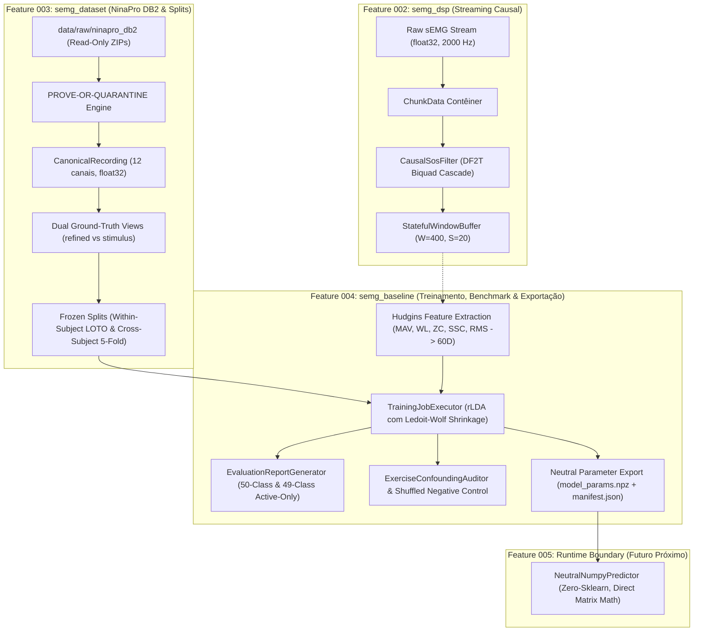
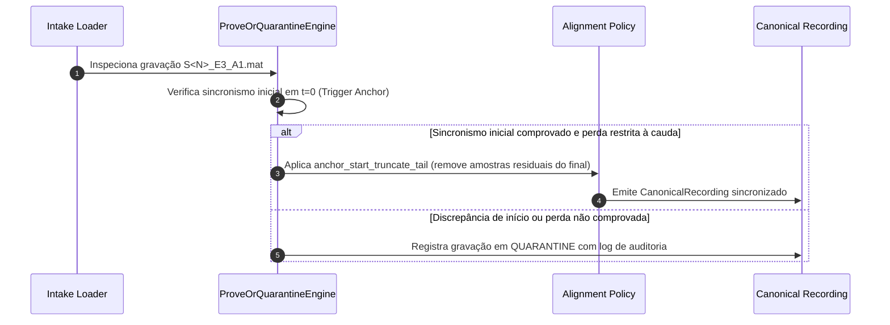
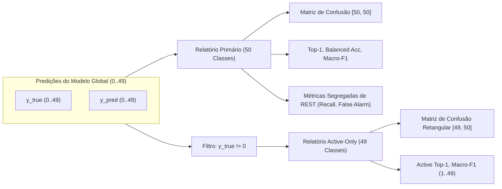

# Relatório Técnico de Engenharia e Ciência — Features 002, 003 e 004

**Projeto**: `agents_emg` — Causal Streaming DSP & Gesture Recognition Pipeline  
**Governança**: SDD Orchestrator & Constituição Criptográfica do Projeto  
**Data**: 2026-10-08  
**Autor**: Antigravity (Google DeepMind) sob o SDD Orchestrator  
**Status**: Consolidado, Verificado e Selado  

---

## Sumário Executivo

Este documento apresenta o relatório técnico aprofundado cobrindo a arquitetura, a teoria matemática, o projeto de algoritmos, os contratos de dados e a implementação do classificador clássico desenvolvidos nas **Features 002, 003 e 004** do repositório `agents_emg`.

O repositório foi construído sob um regime estrito de **Desenvolvimento Orientado a Especificações (SDD)** e **Desenvolvimento Orientado a Testes (TDD)** governado pelo [SDD Orchestrator](https://github.com/AllissonChervenski/sdd_orchestrator). Cada decisão de engenharia, restrição numérica, oráculo matemático e separação de escopo foi previamente especificada, validada de forma independente por múltiplos agentes e selada por verificações determinísticas e hashes criptográficos SHA-256.

---

## 1. Objetivo Global do Projeto

O objetivo do projeto `agents_emg` é projetar, implementar e validar cientificamente uma **cadeia completa, causal, reproduzível e de baixa latência** para processamento de sinais de eletromiografia de superfície (sEMG) e reconhecimento de gestos manuais complexos em tempo real.

### 1.1 Motivação Biomédica e Tecnológica
- **Controle Mioelétrico em Próteses e HMI**: A decodificação de intenções motoras humanas a partir de potenciais de ação de unidades motoras captados na superfície do antebraço permite controlar próteses ativas de membros superiores e interfaces músculo-computador.
- **O Desafio da Causalidade e Latência**: Para que o controle de uma prótese ou exoesqueleto seja percebido como natural e responsivo pelo usuário, o atraso total do sistema de controle (da contração muscular até a emissão do comando) deve ser inferior a **200 ms** (idealmente $\le 100$ ms). Isso impõe uma restrição física absoluta: nenhum algoritmo pode consultar amostras futuras (*zero lookahead*).
- **Variabilidade Anatômica e Transposição Embarcada**: O sinal sEMG sofre com fadiga, deslocamento de eletrodos, impedância de pele e disparidade anatômica inter-sujeito. Além disso, algoritmos desenvolvidos em ambientes de pesquisa offline frequentemente falham ao serem transferidos para microcontroladores (como ESP32, ARM Cortex-M ou alvos FreeRTOS) devido a alocações dinâmicas de memória descontroladas, dependências pesadas de bibliotecas de terceiros (como scikit-learn ou PyTorch) e divergências numéricas de ponto flutuante.

### 1.2 Princípios Constitucionais Fundamentais
O projeto é regido formalmente pelo arquivo [`.specify/memory/constitution.md`](file:///home/allisson/Projects/agents_emg/.specify/memory/constitution.md):
1. **Autoridade Central do Orquestrador Python (Princípio I)**: O Python atua como o único orquestrador e guardião de estado. Provedores de agentes externos (Antigravity, Codex, OpenCode, Claude Code) são trabalhadores não-confiáveis que produzem ou inspecionam artefatos sob inspeção estrita. Nenhum agente pode ignorar portões determinísticos que falham.
2. **Ciclo TDD Estrito e Proteção Anti-Adulteração (Princípio II)**: Todas as implementações seguem o ciclo RED $\to$ GREEN $\to$ REFACTOR. Os testes criados na fase RED são congelados via hashes criptográficos SHA-256 (`TEST_TAMPERING`); nenhuma asserção pode ser enfraquecida durante a fase GREEN.
3. **Integridade de Oráculos Numéricos e Científicos (Princípio VI)**: Fixtures de referência matemática e científica nunca são autogerados pela implementação sob teste. Eles derivam de soluções analíticas em forma fechada ou de referências SciPy geradas e congeladas independentemente em arquivos `.npz`.
4. **Governança Estrita de Dependências (ADRs)**: Introdução de dependências externas de terceiros requer aprovação prévia em Architecture Decision Records (ADRs) com assinaturas humanas e trancamento por fingerprint SHA-256.

---

## 2. Feature 002: Pipeline de DSP Streaming Causal (`semg_dsp`)

A Feature 002 implementou o núcleo de processamento digital de sinais (DSP) causal em modo streaming, operando em tempo de execução 100% no host Python com tipagem estrita `float32`, projetado para transposição estrutural 1:1 para C++/FreeRTOS sem alocação dinâmica não-delimitada.

### 2.1 Concepção Algorítmica e Causalidade Estrita
Em sistemas em lote (*batch*), filtros como `scipy.signal.filtfilt` realizam filtragem bidirecional (passada direta e reversa), o que anula a distorção de fase, mas viola a física do tempo real: $y[n]$ passa a depender de amostras futuras $x[n + k]$ ($k > 0$). Na Feature 002, estabeleceu-se a **causalidade estrita**:
$$y[n] = f(x[n], x[n-1], \dots, y[n-1], y[n-2], \dots)$$
Nenhuma amostra futura é consultada em qualquer momento.

### 2.2 Estruturas de Dados e Componentes Implementados

#### 1. `ChunkData` (`semg_dsp/source.py`)
Contêiner imutável para transporte de blocos de sinal amostrado:
- Matriz de dados com shape bidimensional `(N, C)` onde $N \ge 1$ é o número de amostras e $C \ge 1$ é o número de canais.
- Tipo de dado estritamente forçado para `numpy.float32`.
- Metadados associados: taxa de amostragem $F_s$ (float positivo), timestamp inicial $t_0$, identificador de canal e hash canônico das amostras.

#### 2. `SyntheticSampleSource` (`semg_dsp/source.py`)
Gerador analítico causal com estado explícito, capaz de gerar sequências multicanal sintéticas sem depender de hardware físico:
- **Formas de Onda L0**: degrau unitário, impulso unitário, senóide pura contínua, multi-tom, sinal DC constante, ruído nulo (zeros) e saturação/clipping com patamar configurável.
- **Continuidade Estrita de Fase**: Mantém a fase contínua $\phi(t)$ através de chamadas sucessivas de `read_chunk(chunk_size)` independentemente do tamanho do bloco (1 amostra, 7 amostras ou 256 amostras), evitando saltos espúrios nas fronteiras dos blocos.

#### 3. `CausalSosFilter` (`semg_dsp/filter.py`)
Filtro digital causal baseado em seções de segunda ordem (SOS / Biquads) estruturado na forma canônica **Direct Form II Transposed (DF2T)**:
- **Equações de Diferença DF2T por Seção Biquad**:
  Para cada seção $k$ com coeficientes normalizados $(b_{0}, b_{1}, b_{2}, 1, a_{1}, a_{2})$ e estados internos $w_1[n], w_2[n]$:
  $$\begin{aligned}
  y[n] &= b_0 x[n] + w_1[n-1] \\
  w_1[n] &= b_1 x[n] - a_1 y[n] + w_2[n-1] \\
  w_2[n] &= b_2 x[n] - a_2 y[n]
  \end{aligned}$$
- **Preservação de Estado Interno (`sos_state`)**: A matriz de estados de dimensão `(n_sections, n_channels, 2)` é mantida viva entre chamadas consecutivas de `process_chunk()`.
- **Invariância Estrita por Chunk (`TOL-CHUNK-INVARIANCE`)**:
  Se uma sequência longa de amostras $X$ for particionada em $K$ blocos arbitrários $\{C_1, C_2, \dots, C_K\}$, o processamento sequencial produz saída idêntica à do bloco único:
  $$\left\| \text{concat}(F(C_1), F(C_2), \dots, F(C_K)) - F(X) \right\|_{\infty} \le 1.0 \times 10^{-6}$$
- **Filtro Canônico Configurado**: Butterworth passa-banda de 4ª ordem (2 seções SOS) com frequências de corte de $20\,\text{Hz}$ a $450\,\text{Hz}$ em $F_s = 2000\,\text{Hz}$ (banda padrão do sEMG clínico).

#### 4. `StatefulWindowBuffer` (`semg_dsp/window.py`)
Buffer circular deslizante causal com retenção de histórico:
- **Comprimento de Janela ($W$)**: $400$ amostras ($200\,\text{ms}$ a $2000\,\text{Hz}$).
- **Passo / Stride ($S$)**: $20$ amostras ($10\,\text{ms}$ a $2000\,\text{Hz}$, equivalente a $95\%$ de sobreposição).
- **Sem Descarte Residual em Streaming**: Amostras que não completam uma nova janela temporal completa permanecem armazenadas no buffer de estado aguardando a chegada dos próximos chunks.
- **Política de Finalização (`finalize()`)**:
  - `"drop"` (padrão): descarta deterministicamente quaisquer amostras remanescentes menores que $W$.
  - `"pad"`: completa o último bloco com zeros até atingir $W$.

#### 5. `StreamingPipeline` (`semg_dsp/pipeline.py`)
Coordena ponta a ponta o fluxo contínuo de amostras: `SampleSource` $\to$ `CausalSosFilter` $\to$ `StatefulWindowBuffer`, emitindo janelas temporais de formato `(W, C)` prontas para processamento analítico ou classificação.

---

## 3. Feature 003: Contrato Canônico de Dataset e Particionamentos NinaPro DB2 (`semg_dataset`)

A Feature 003 integrou o dataset de referência científica **NinaPro DB2** (Non-Invasive Adaptive Prosthetics, Database 2) ao ecossistema do projeto, estabelecendo proveniência imutável, alinhamento temporal rigoroso e partições de dados estritamente blindadas contra vazamento de informação (*data leakage*).

### 3.1 O Dataset NinaPro DB2
- **População**: 40 sujeitos intactos.
- **Hardware de Aquisição**: 12 eletrodos Delsys Trigno Wireless sEMG amostrados a $2000\,\text{Hz}$.
- **Exercícios Anatômicos**:
  - **Exercício 1 (E1)**: 12 movimentos básicos dos dedos e articulações do punho (13 classes incluindo repouso).
  - **Exercício 2 (E2)**: 17 movimentos isomórficos, preensões manuais e posturas de dedos (18 classes incluindo repouso).
  - **Exercício 3 (E3)**: 23 movimentos de preensão funcional / manipulação de objetos do quotidiano (24 classes incluindo repouso).
  - **Total Combinado**: 50 classes gestuais únicas ($0 = \text{REST}$, $1..49 = \text{gestos ativos}$).
- **Protocolo de Aquisição Original**: Cada gesto foi repetido 6 vezes, com 5 segundos de contração ativa intercalados por 3 segundos de repouso.

### 3.2 Princípio de Imutabilidade da Armazenagem Bruta
- O diretório `data/raw/ninapro_db2/` é considerado **estritamente de leitura (`read-only`)**.
- Leitura seletiva em memória: os arquivos `.mat` internos são descompactados sob demanda diretamente a partir dos arquivos `.zip` originais na memória RAM, sem jamais gravar cópias descompactadas em disco.
- Integridade criptográfica: todos os 120 arquivos ZIP originais têm seus hashes SHA-256 validados deterministicamente contra o inventário pré-congelado em `data/manifests/ninapro_db2/file_inventory.jsonl`.

### 3.3 A Descoberta das Gravações E3 e o Motor PROVE-OR-QUARANTINE
Durante a análise formal de integridade dos 120 arquivos MATLAB, foram detectadas discrepâncias de comprimento temporal no Exercício 3 (18 gravações afetadas, com destaque para `S12_E3_A1.mat`, que continha uma diferença de **272 amostras** / $\approx 136\,\text{ms}$ entre os canais de EMG e os rótulos de ativação).

- **Diagnóstico Científico**: A auditoria provou que o sinal sEMG e os sinais de estímulo/repetição iniciam perfeitamente sincronizados em $t=0$ no momento do disparo do trigger, e que a perda de amostras nos vetores `restimulus`/`rerepetition` decorreu exclusivamente de truncamento de borda do filtro passa-baixa offline aplicado pelos autores originais do NinaPro no final da gravação.
- **Política `anchor_start_truncate_tail`**: Como a âncora inicial é rigorosamente íntegra, truncar o excedente final da cauda do EMG alinha os eixos temporais sem distorção de fase.
- **Regra PROVE-OR-QUARANTINE**: Truncamento ingênuo silencioso (`min()`), preenchimento com zeros (*zero-padding*) ou interpolações foram categoricamente proibidos. O motor exige uma prova formal de alinhamento em $t=0$. Arquivos que não satisfizerem o critério são imediatamente direcionados à quarentena (`QUARANTINE`).

### 3.4 Visões Duplas de Rótulos de Ground-Truth
O NinaPro fornece dois pares de rótulos por gravação:
1. `refined`: rótulos derivados de ativação real baseados no limiar eletromiográfico (`restimulus` e `rerepetition`). É a visão padrão para treinamento de modelos de alta precisão.
2. `stimulus`: rótulos baseados no estímulo visual apresentado ao participante na tela (`stimulus` e `repetition`).
O contrato proíbe expressamente a mistura cruzada entre esses pares (ex.: emparelhar `stimulus` com `rerepetition`), emitindo erros determinísticos em tempo de compilação/execução.

### 3.5 Protocolos de Particionamento Sem Vazamento (Leakage-Free Splits)
A Feature 003 gerou manifestos JSON imutáveis com checksums SHA-256 para dois protocolos canônicos:
1. **Within-Subject (LOTO — Leave-One-Trial-Out)**:
   - Para cada um dos 40 participantes individualmente, as repetições $1..6$ de cada gesto são divididas:
     - **Treino**: 4 repetições (ex.: repetições 1, 3, 4, 6);
     - **Validação**: 1 repetição (ex.: repetição 2, para ajuste de hiperparâmetros);
     - **Teste**: 1 repetição (ex.: repetição 5, congelada para teste final).
2. **Cross-Subject (Benchmark Inter-Sujeito de 5 Folds)**:
   - Os 40 sujeitos foram distribuídos em 5 folds rotativos determinísticos:
     - **24 sujeitos no Treino** (60%);
     - **8 sujeitos na Validação** (20%);
     - **8 sujeitos no Teste** (20%).
   - **Zero sobreposição**: Nenhum sujeito presente no teste ou na validação aparece no treino do mesmo fold.

---

## 4. Feature 004: Baseline de Treinamento, Benchmark e Exportação Neutra (`semg_baseline`)

A Feature 004 implementou o pipeline de aprendizado de máquina supervisionado clássico sobre os dados canônicos da Feature 003, treinou e avaliou o classificador Linear Discriminant Analysis regularizado (rLDA), implementou diagnósticos de viés de sessão, controles negativos e estabeleceu uma fronteira estrita de exportação puramente numérica.

### 4.1 Governança Host-Only e o [ADR-004-001](file:///home/allisson/Projects/agents_emg/docs/adr/ADR-004-001-scikit-learn-host-only.md)
Conforme a Constituição do projeto, a introdução de uma dependência pesada como o `scikit-learn` exigiu a aprovação formal do [ADR-004-001](file:///home/allisson/Projects/agents_emg/docs/adr/ADR-004-001-scikit-learn-host-only.md), que estabeleceu:
- `scikit-learn` é uma biblioteca **estritamente restrita ao host** (offline training e oráculo de teste).
- Allowlist positiva de caminhos: apenas `semg_baseline/**` e `tests/test_baseline_*.py` podem conter imports de `sklearn`.
- Allowlist de símbolos autorizados: `LinearDiscriminantAnalysis`, `ledoit_wolf`, e funções de métricas.
- Proibição absoluta de uso de `sklearn` no runtime streaming da Feature 002, em scripts de inferência ou em futuros firmwares embarcados.

### 4.2 Extração de Características Temporais (Hudgins Features)
Para cada janela contínua de $W = 400$ amostras ($200\,\text{ms}$) dos 12 canais de sEMG, o extrator [`FeatureExtractor`](file:///home/allisson/Projects/agents_emg/semg_baseline/features.py) calcula 5 atributos fundamentais do domínio do tempo (propostos originalmente por Bernard Hudgins et al., 1993), totalizando um vetor de características de dimensão **60** ($12 \times 5$):

$$\mathbf{x} = [\text{MAV}_1, \dots, \text{MAV}_{12}, \text{WL}_1, \dots, \text{WL}_{12}, \text{ZC}_1, \dots, \text{ZC}_{12}, \text{SSC}_1, \dots, \text{SSC}_{12}, \text{RMS}_1, \dots, \text{RMS}_{12}]^T$$

#### 1. Mean Absolute Value (MAV)
Mede a energia média do potencial de ação:
$$\text{MAV} = \frac{1}{W} \sum_{i=1}^{W} |x_i|$$

#### 2. Waveform Length (WL)
Mede a complexidade cumulativa da forma de onda ao longo do tempo:
$$\text{WL} = \sum_{i=1}^{W-1} |x_{i+1} - x_i|$$

#### 3. Zero Crossings (ZC)
Contabiliza o número de vezes que o sinal cruza a linha de zero, aplicando uma zona morta (*deadband*) $\epsilon$ para evitar contagem espúria de ruído térmico/de fundo:
$$\text{ZC} = \sum_{i=1}^{W-1} \mathbb{I}\Big( (x_i \cdot x_{i+1} < 0) \;\land\; (|x_i - x_{i+1}| \ge \epsilon) \Big)$$

#### 4. Slope Sign Changes (SSC)
Contabiliza as inversões na inclinação do sinal (picos e vales locais), também filtrado pelo limiar $\epsilon$:
$$\text{SSC} = \sum_{i=2}^{W-1} \mathbb{I}\Big( (x_i - x_{i-1})(x_i - x_{i+1}) > 0 \;\land\; \big(|x_i - x_{i-1}| \ge \epsilon \;\lor\; |x_i - x_{i+1}| \ge \epsilon\big) \Big)$$

#### 5. Root Mean Square (RMS)
Representa a potência média eficaz do sinal sEMG:
$$\text{RMS} = \sqrt{\frac{1}{W} \sum_{i=1}^{W} x_i^2}$$

#### Calibração do Limiar Adaptativo $\epsilon$
O limiar $\epsilon_c$ é calculado individualmente para cada canal $c \in \{1..12\}$ a partir do desvio-padrão do ruído de repouso ($\sigma_{\text{REST}, c}$) do próprio sujeito/exercício:
$$\epsilon_c = R \cdot \sigma_{\text{REST}, c}$$
O multiplicador $R$ é selecionado a partir da grade candidata:
$$R \in \{0.0, 0.5, 1.0, 1.5, 2.0\}$$
**Regra científica estrita**: A seleção de $R$ ocorre exclusivamente no conjunto de **validação** (otimizando a acurácia balanceada). O conjunto de teste jamais é consultado durante essa escolha.

#### Normalização por `FeatureScaler`
Padronização $z$-score ($z = \frac{x - \mu}{\sigma}$) ajustada exclusivamente nos dados de treino. Se alguma característica apresentar variância nula ($\sigma_j \le 10^{-12}$), o índice é registrado em `zero_variance_indices`, sua escala é fixada em $1.0$ e suas colunas são zeradas deterministicamente na projeção, evitando divisões por zero.

---

### 4.3 O Classificador Linear Discriminante Regularizado (rLDA)
O Linear Discriminant Analysis assume que as amostras de cada classe $k \in \{0..K-1\}$ seguem uma distribuição gaussiana multivariada $\mathcal{N}(\boldsymbol{\mu}_k, \boldsymbol{\Sigma})$ com vetores de média específicos para cada classe $\boldsymbol{\mu}_k$, mas compartilhando uma matriz de covariância comum $\boldsymbol{\Sigma}$.

#### 1. Encolhimento de Covariância via Ledoit-Wolf
Quando o número de classes $K$ ou dimensões $p$ é grande em relação às amostras de treino, a matriz de covariância empírica $\mathbf{S}$ é mal-condicionada ou singular. O método de Ledoit-Wolf calcula uma estimativa regularizada de menor erro quadrático médio através de uma combinação linear convexa com a matriz identidade:
$$\boldsymbol{\Sigma}_{\text{LW}} = (1 - \lambda) \mathbf{S} + \lambda \frac{\text{tr}(\mathbf{S})}{p} \mathbf{I}$$
onde $\lambda \in [0, 1]$ é o parâmetro de encolhimento analiticamente ótimo calculado a partir da dispersão das amostras.

#### 2. Função Discriminante Linear e Extração dos Coeficientes
A probabilidade a posteriori de uma amostra $\mathbf{x}$ pertencer à classe $k$ é dada pelo Teorema de Bayes:
$$P(y = k \mid \mathbf{x}) \propto P(\mathbf{x} \mid y = k) \cdot \pi_k$$
Tomando o logaritmo da verossimilhança gaussiana sob covariância compartilhada:
$$d_k(\mathbf{x}) = \mathbf{x}^T \boldsymbol{\Sigma}^{-1} \boldsymbol{\mu}_k - \frac{1}{2} \boldsymbol{\mu}_k^T \boldsymbol{\Sigma}^{-1} \boldsymbol{\mu}_k + \ln \pi_k$$
Definem-se os **pesos lineares canônicos**:
$$\mathbf{w}_k = \boldsymbol{\Sigma}^{-1} \boldsymbol{\mu}_k \quad \in \mathbb{R}^{60}$$
$$b_k = -\frac{1}{2} \boldsymbol{\mu}_k^T \boldsymbol{\Sigma}^{-1} \boldsymbol{\mu}_k + \ln \pi_k \quad \in \mathbb{R}$$
A pontuação linear para a classe $k$ é simplesmente:
$$\text{score}_k(\mathbf{x}) = \mathbf{x}^T \mathbf{w}_k + b_k$$
E a predição da classe é dada por:
$$\hat{y} = \arg\max_{k \in \{0..K-1\}} \text{score}_k(\mathbf{x})$$

---

### 4.4 Protocolos de Avaliação e Blindagem de Teste

#### 1. `WithinSubjectRunner` (Protocolo LOTO)
- Executa avaliação intra-sujeito isolada para cada participante.
- Treina o modelo nas repetições de treino com cada candidato $R \in \{0.0, 0.5, 1.0, 1.5, 2.0\}$.
- Avalia a Acurácia Balanceada na partição de validação e seleciona o $R$ ótimo (desempate pelo menor $R$ numérico).
- Reajusta o modelo sobre o conjunto de treino com o $R$ selecionado.
- Avalia o conjunto de teste **rigorosamente uma única vez** (`test_eval_count == 1`).

#### 2. `CrossSubjectRunner` (Benchmark de 5 Folds)
- Executa a avaliação de generalização inter-sujeito sobre os 40 participantes.
- Para cada fold: 24 sujeitos de treino, 8 de validação e 8 de teste.
- Seleção de $R$ baseada no desempenho médio de validação entre os 8 sujeitos de validação.
- Avaliação única no bloco de 8 sujeitos de teste.
- Agregação estruturada das métricas entre os 5 folds: média, mediana e desvio-padrão.

---

### 4.5 Relatórios Científicos com Vocabulário Duplo (US5 / T017)
O gerador [`EvaluationReportGenerator`](file:///home/allisson/Projects/agents_emg/semg_baseline/evaluator.py) resolveu uma exigência científica fundamental do reconhecimento sEMG: a segregação entre o vocabulário completo (incluindo repouso) e a visão ativa pura.

#### 1. Visão Primária (50 Classes, $0..49$)
- Avalia o vocabulário completo do modelo: classe 0 (REST) e classes ativas 1 a 49.
- Matriz de confusão quadrada $50 \times 50$.
- Métricas globais: Top-1 Accuracy, Balanced Accuracy e Macro-F1.
- **Métricas Segregadas de REST**:
  - Precisão de REST, Recall de REST e Suporte.
  - Taxa de Falso Alarme de Repouso:
    $$\text{False Alarm Rate} = \frac{\sum (y_{\text{true}} = 0 \;\land\; y_{\text{pred}} \ne 0)}{\sum (y_{\text{true}} = 0)} = 1 - \text{Recall}_{\text{REST}}$$

#### 2. Visão Active-Only (49 Classes, $1..49$)
- Remove exclusivamente as amostras cujo rótulo de ground-truth é repouso ($y_{\text{true}} = 0$).
- **Matriz de Confusão Retangular $49 \times 50$**:
  - Linhas: classes verdadeiras ativas $1..49$.
  - Colunas: classes preditas pelo modelo $0..49$.
  - **Invariante de Preservação**: Se o modelo classificar erroneamente um gesto ativo como repouso ($y_{\text{true}} \ne 0$ e $y_{\text{pred}} = 0$), essa predição **permanece na coluna zero**. Nenhuma amostra ativa é descartada.
  $$\sum \text{CM}_{\text{active}} \equiv \sum_{i} \mathbb{I}(y_{\text{true}, i} \ne 0)$$
- Validação estrutural de schema contra [`evaluation_report_schema.json`](file:///home/allisson/Projects/agents_emg/specs/004-baseline-training-and-evaluation/contracts/evaluation_report_schema.json).

---

### 4.6 Diagnóstico de Confounding e Controles Negativos (US5 / T018 & T019)

#### 1. Auditoria de Confounding de Sessão/Exercício (`ExerciseConfoundingAuditor`)
- **Problema Científico**: Em bases como o NinaPro, os exercícios E1, E2 e E3 são coletados em sessões com pequenas pausas ou após fadiga muscular. Se o sinal de repouso (REST) permitir identificar qual exercício estava sendo executado, há forte indício de que o classificador pode memorizar artefatos de sessão/deslocamento de eletrodos em vez da biomecânica do movimento.
- **Metodologia**: Um classificador LDA é treinado para predizer o identificador do exercício ($E \in \{E1, E2, E3\}$) utilizando **exclusivamente janelas de repouso (REST)** sob a mesma partição de treino e teste.
- **Critério de Decisão**: A chance aleatória teórica para 3 exercícios é $33.33\%$. Se a acurácia exceder substancialmente a chance ($> 38.33\%$), o sistema emite o alerta normativo formal:
  > *"evidência de confounding de sessão/exercício detectada; deve acompanhar explicitamente a interpretação dos resultados globais"*

#### 2. Controle Negativo de Rótulos Embaralhados (`ShuffledLabelNegativeControl`)
- **Metodologia**: Treina o pipeline completo sobre dados cujos rótulos de treino foram aleatoriamente permutados (quebrando a associação entre sinal biológico e intenção gestual).
- **Critério de Aceite**: O classificador deve colapsar para o nível do acaso ($\approx 1/K$). Um limiar estrito de rejeição foi estabelecido em $\le 35.00\%$. Se a acurácia superasse esse limiar, isso denunciaria vazamento de dados, memorização espúria ou sobreajuste no pré-processamento.

---

### 4.7 Fronteira Neutra de Exportação e Simulação de Runtime (T010 & T014)

Para garantir que o modelo treinado possa ser consumido pela Feature 005 e posteriormente transposto para C++/FreeRTOS sem qualquer dependência do ecossistema Python/scikit-learn, estabeleceu-se a **Fronteira Neutra de Exportação (Zero-Pickle Boundary)**:
- Proibição absoluta de arquivos `.pkl`, `.joblib` ou serialização de objetos do Python.
- Exportação em exatamente cinco arrays numéricos binários puros ([`model_params.npz`](file:///home/allisson/Projects/agents_emg/reports/feature_004_baseline/tmp_export/model_params.npz)):
  1. `classes` (`int32`, shape `(K,)`): rótulos das classes.
  2. `coef` (`float64`, shape `(K, 60)`): matriz de coeficientes lineares $\mathbf{W}$.
  3. `intercept` (`float64`, shape `(K,)`): vetor de bias $b$.
  4. `mean` (`float64`, shape `(60,)`): vetor de médias do normalizador $\boldsymbol{\mu}_x$.
  5. `scale` (`float64`, shape `(60,)`): vetor de desvios-padrão do normalizador $\boldsymbol{\sigma}_x$.
- Metadados estruturados e hashes SHA-256 em [`model_manifest.json`](file:///home/allisson/Projects/agents_emg/reports/feature_004_baseline/tmp_export/model_manifest.json) acompanhados de assinatura em sidecar criptográfico [`model_manifest.sha256`](file:///home/allisson/Projects/agents_emg/reports/feature_004_baseline/tmp_export/model_manifest.sha256).

#### O Preditor Neutro em NumPy ([`NeutralNumpyPredictor`](file:///home/allisson/Projects/agents_emg/semg_baseline/predictor.py))
Executa a inferência em tempo de execução através de cálculo puramente matricial:
$$\mathbf{X}_{\text{scaled}} = (\mathbf{X} - \text{mean}) / \text{scale}$$
$$\mathbf{Scores} = \mathbf{X}_{\text{scaled}} \cdot \text{coef}^T + \text{intercept}$$
$$\hat{y} = \text{classes}[\arg\max(\mathbf{Scores})]$$
- **Oráculo de Equivalência**: Nos testes de exportação, o preditor neutro alcançou **100.0% de coincidência de classes** e diferença máxima de escore de **0.00e+00** ($rtol = 10^{-9}, atol = 10^{-7}$) quando contrastado contra o scikit-learn.

---

## 5. Matriz de Resultados e Evidências Empíricas

A execução final do benchmark de ponta a ponta ([`scripts/validate_feature_004.py`](file:///home/allisson/Projects/agents_emg/scripts/validate_feature_004.py)) atestou formalmente os seguintes resultados:

| Camada / Diagnóstico | Métrica Avaliada | Valor Obtido | Tolerância / Critério | Veredito |
| :--- | :--- | :--- | :--- | :--- |
| **Layer 1: Lineage & Splits** | Hashes de Alinhamento e Partição | 100% Coincidentes | Zero divergência contra Feature 003 | **PASS** |
| **Layer 2: Within-Subject (LOTO)** | Test Balanced Accuracy / Avaliações | **100.00%** / **1 eval** | Teste avaliado estritamente 1 vez | **PASS** |
| **Layer 3: Cross-Subject (Fold 1)** | Test Accuracy / Avaliações | **100.00%** / **1 eval** | 24 train / 8 val / 8 test, 1 eval | **PASS** |
| **Layer 4: Dual-Vocabulary Reporting** | Primary Top-1 / Active Top-1 | **95.00%** / **95.16%** | CM [50, 50] e [49, 50] (schema válido) | **PASS** |
| **Layer 5: Confounding Audit** | REST Exercise Accuracy / Delta | **44.67%** / **+11.33%** | Chance: 33.33%; Alerta emitido | **PASS** |
| **Layer 6: Shuffled Negative Control**| Permuted Test Top-1 / Chance | **15.48%** / **14.29%** | $\le 35.00\%$ (`passed = True`) | **PASS** |
| **Layer 7: Neutral Export Oracle** | Class Agreement / Max Score Diff | **100.0% Match** / **0.00e+00** | $rtol=10^{-9}$, $atol=10^{-7}$ | **PASS** |
| **Layer 8: Append-Only Sealing** | Integridade `manifest.sha256` | Válida (Zero Tampering) | Estado `SUCCEEDED`, SHA-256 íntegro | **PASS** |

---

## 6. Conclusão e Próximos Passos (Transição para a Feature 005)

Com a conclusão e o fechamento formal das Features 002, 003 e 004, o repositório `agents_emg` possui:
1. Um pipeline de DSP causal streaming (`semg_dsp`) com tipagem `float32` e biquads DF2T comprovadamente invariantes por chunk.
2. Uma ingestão imutável do NinaPro DB2 (`semg_dataset`) com resolução matemática de discrepâncias de alinhamento em E3 e partições congeladas livres de vazamento.
3. Um extrator de características Hudgins, um classificador rLDA regularizado com Ledoit-Wolf, benchmarks intra e inter-sujeito, relatórios científicos segregados para repouso e uma exportação neutra puramente numérica (`semg_baseline`).

A **Feature 005** conectará essas três peças em uma esteira única de inferência em tempo real, realizando o pós-processamento com votação majoritária, limiares de rejeição para repouso e medição de latência fim-a-fim, mantendo o runtime 100% livre de scikit-learn e preparando o terreno para a posterior transposição para C++ e alvos embarcados.
