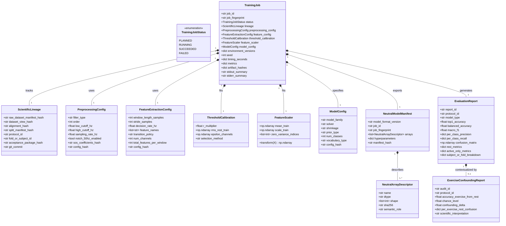

# Phase 1: Data Model — Feature 004

**Feature**: `004-baseline-training-and-evaluation`  
**Status**: Completed  
**Inputs**: Feature Specification (`spec.md`), Research Decisions (`research.md`)

---

## Domain Entities & Relationships



---

## Entity Details & Invariants

### 1. `ScientificLineage`
- **Purpose**: Verifiable cryptographic chain connecting the training execution to frozen Feature 003 artifacts.
- **Fields**:
  - `raw_dataset_manifest_hash`: Hexadecimal SHA-256 of NinaPro DB2 baseline intake inventory.
  - `dataset_view_hash`: Hexadecimal SHA-256 of the active dataset view (`refined` or `stimulus`).
  - `alignment_hash`: Cryptographic signature / version of the PROVE-OR-QUARANTINE alignment decision.
  - `split_manifest_hash`: Hexadecimal SHA-256 of the split manifest (`splits_within_subject.json` or `splits_cross_subject.json`).
  - `protocol_id`: `"within_subject"` or `"cross_subject"`.
  - `fold_or_subject_id`: Identifier of the specific partition (`"S1"`..`"S40"` or `"fold_1"`..`"fold_5"`).
  - `acceptance_package_hash`: Hash of the Feature 003 acceptance manifest (`manifest.sha256`).
  - `git_commit`: Active git commit hash.
- **Invariants**:
  - All hashes must match the frozen Feature 003 acceptance artifacts exactly.
  - No training execution may alter, recompute, or bypass any lineage hash.

---

### 2. `PreprocessingConfig`
- **Purpose**: Immutable specification of the causal signal conditioning pipeline.
- **Fields**:
  - `filter_type`: `"butterworth_causal_sos"`.
  - `order`: `4`.
  - `low_cutoff_hz`: `20.0`.
  - `high_cutoff_hz`: `450.0`.
  - `sampling_rate_hz`: `2000.0`.
  - `notch_50hz_enabled`: `False` (omitted per empirical spectral audit).
  - `sos_coefficients_hash`: Hexadecimal SHA-256 digest of the SOS coefficient array.
  - `config_hash`: Hexadecimal SHA-256 of serialized JSON configuration.
- **Invariants**:
  - Preprocessing parameters are owned strictly by Feature 004; no silent inheritance from Feature 002.
  - `notch_50hz_enabled` must remain `False` for the canonical baseline.

---

### 3. `FeatureExtractionConfig`
- **Purpose**: Defines temporal segmentation and multi-channel feature extraction.
- **Fields**:
  - `window_length_samples`: `400` ($200\,\text{ms}$ at 2000 Hz).
  - `stride_samples`: `100` ($50\,\text{ms}$ at 2000 Hz, 75% overlap).
  - `decision_rate_hz`: `20.0`.
  - `feature_names`: `["MAV", "RMS", "WL", "ZC", "SSC"]`.
  - `transition_policy`: `"pure_window_steady_state"`.
  - `num_channels`: `12`.
  - `total_features_per_window`: `60` ($12 \times 5$).
  - `config_hash`: Hexadecimal SHA-256 digest of configuration.
- **Invariants**:
  - No window may cross `repetition_unit` or partition boundaries.
  - Transition/mixed windows (REST ↔ ACTIVE, ACTIVE ↔ ACTIVE) are strictly excluded from steady-state datasets.

---

### 4. `ThresholdCalibration`
- **Purpose**: Encapsulates data-driven deadzone thresholds for ZC and SSC.
- **Fields**:
  - `r_multiplier`: Value from candidate grid $\{0.5, 1.0, 1.5, 2.0, 3.0\}$.
  - `rms_rest_train`: Array of shape `(12,)` containing baseline rest RMS per channel computed strictly on TRAIN.
  - `epsilon_channels`: Computed deadzone thresholds: $\epsilon[\text{ch}] = R \times \text{RMS\_rest\_train}[\text{ch}]$.
  - `selection_method`: `"training_pool_validation"`.
- **Invariants**:
  - `rms_rest_train` and `r_multiplier` must NEVER observe validation or test splits.
  - Selected $R$ must be uniform across all 12 channels for a given model fit.

---

### 5. `FeatureScaler`
- **Purpose**: Train-only custom Z-score feature normalization.
- **Fields**:
  - `mean_train`: Array of shape `(60,)` with feature means computed strictly on TRAIN.
  - `scale_train`: Array of shape `(60,)` with feature standard deviations computed strictly on TRAIN.
  - `zero_variance_indices`: List of feature indices where $\sigma_j == 0$, receiving $\text{scale}_j = 1.0$.
- **Invariants**:
  - `sklearn.preprocessing.StandardScaler` is strictly prohibited.
  - Transforming validation and test partitions is strictly stateless: $z = (x - \mu) / \sigma$.

---

### 6. `ModelConfig`
- **Purpose**: Specification of Regularized LDA hyperparameters.
- **Fields**:
  - `model_family`: `"regularized_lda"`.
  - `solver`: `"lsqr"`.
  - `shrinkage`: `"auto"` (Ledoit-Wolf analytic shrinkage).
  - `prior_type`: `"uniform"` ($P(c) = 1/K$, canonical primary) or `"empirical"` ($P(c) = N_c / N_{\text{train}}$, secondary reference).
  - `num_classes`: `50` (primary) or `18` / `24` / `10` (exercise-stratified secondary).
  - `vocabulary_type`: `"global_50_class"`, `"exercise_E1"`, `"exercise_E2"`, or `"exercise_E3"`.
  - `config_hash`: Hexadecimal SHA-256 digest of configuration.
- **Invariants**:
  - Canonical baseline must use `prior_type = "uniform"`.
  - Empirical and uniform priors must be fitted as separate model instances.

---

### 7. `TrainingJob`
- **Purpose**: Immutable, append-only container recording the entire execution lifecycle.
- **State Machine**:
  ```mermaid
  stateDiagram-v2
      [*] --> PLANNED: job registered with deterministic fingerprint
      PLANNED --> RUNNING: orchestrator launches execution
      RUNNING --> SUCCEEDED: fit complete, neutral export verified, oracle check PASS
      RUNNING --> FAILED: postcondition failed, timeout, exception, or oracle mismatch
      SUCCEEDED --> [*]: job immutable (append-only)
      FAILED --> [*]: failure logged (append-only)
  ```
- **Fields**:
  - `job_id`: Unique identifier formatted as `job_<protocol>_<partition>_<vocab>_<timestamp>`.
  - `job_fingerprint`: Deterministic SHA-256 hash computed from scientific inputs:
    $$\text{fingerprint} = \text{SHA256}(\text{lineage\_hashes} + \text{configs} + \text{seed} + \text{commit} + \text{lockfile\_hash})$$
  - `status`: `TrainingJobStatus` (`PLANNED`, `RUNNING`, `SUCCEEDED`, `FAILED`).
  - `lineage`: `ScientificLineage` instance.
  - `preprocessing_config`: `PreprocessingConfig` instance.
  - `feature_config`: `FeatureExtractionConfig` instance.
  - `threshold_calibration`: `ThresholdCalibration` instance.
  - `feature_scaler`: `FeatureScaler` instance.
  - `model_config`: `ModelConfig` instance.
  - `environment_versions`: Python, NumPy, SciPy, Scikit-learn, OS, CPU details.
  - `seed`: Integer random seed.
  - `timing_seconds`: Timers for preprocessing, feature extraction, fitting, and evaluation.
  - `metrics`: Dictionary of computed metrics.
  - `artifact_hashes`: SHA-256 digests of exported files (`model_params.npz`, logs, matrices).
  - `stdout_summary`: First/last 20 lines of execution stdout.
  - `stderr_summary`: Error log summary if failed.
- **Invariants**:
  - Completed jobs are append-only; an existing job directory is never overwritten.
  - Volatile fields (timestamps, PID, local filesystem paths) must NEVER participate in `job_fingerprint`.

---

### 8. `NeutralModelManifest` & `NeutralArrayDescriptor`
- **Purpose**: Authoritative contract describing exported pure-numeric parameters for Feature 005.
- **Fields**:
  - `model_format_version`: `"1.0.0"`.
  - `job_id`: Associated `TrainingJob` identifier.
  - `job_fingerprint`: Associated deterministic job fingerprint.
  - `arrays`: List of `NeutralArrayDescriptor` items describing the contents of `model_params.npz`:
    - `classes`: shape `(K,)`, dtype `int32`, role `"class_labels"`.
    - `coef`: shape `(K, 60)`, dtype `float64`, role `"discriminant_coefficients"`.
    - `intercept`: shape `(K,)`, dtype `float64`, role `"discriminant_intercepts"`.
    - `feature_mean`: shape `(60,)`, dtype `float64`, role `"scaler_mean"`.
    - `feature_scale`: shape `(60,)`, dtype `float64`, role `"scaler_scale"`.
  - `manifest_hash`: SHA-256 digest of `model_manifest.json`.
- **Invariants**:
  - Zero Python pickle, joblib dumps, or sklearn objects permitted.
  - Binary content of `model_params.npz` must match array descriptors exactly in shape, dtype, and SHA-256.

---

### 9. `EvaluationReport` & `ExerciseConfoundingReport`
- **Purpose**: Standardized structured evaluation reports.
- **Fields**:
  - `report_id`: Unique identifier.
  - `protocol_id`: `"within_subject"` or `"cross_subject"`.
  - `model_type`: `"global_50_class"`, `"exercise_E1"`, `"exercise_E2"`, `"exercise_E3"`.
  - `top1_accuracy`: Float in $[0.0, 1.0]$.
  - `balanced_accuracy`: Float in $[0.0, 1.0]$.
  - `macro_f1`: Float in $[0.0, 1.0]$.
  - `per_class_precision`: Dict mapping class label string to float.
  - `per_class_recall`: Dict mapping class label string to float.
  - `confusion_matrix`: Array of shape `(K, K)`.
  - `rest_metrics`: Specific precision, recall, and false-alarm rate for REST (class 0).
  - `active_only_metrics`: Accuracy and Macro-F1 computed strictly over classes 1..49.
  - `subject_or_fold_breakdown`: Per-subject / per-fold breakdowns with mean, median, std.
- **Invariants**:
  - 50-class primary and 49-class active-only metrics must remain segregated.
  - Averaging E1, E2, E3 to replace global metrics is prohibited.
