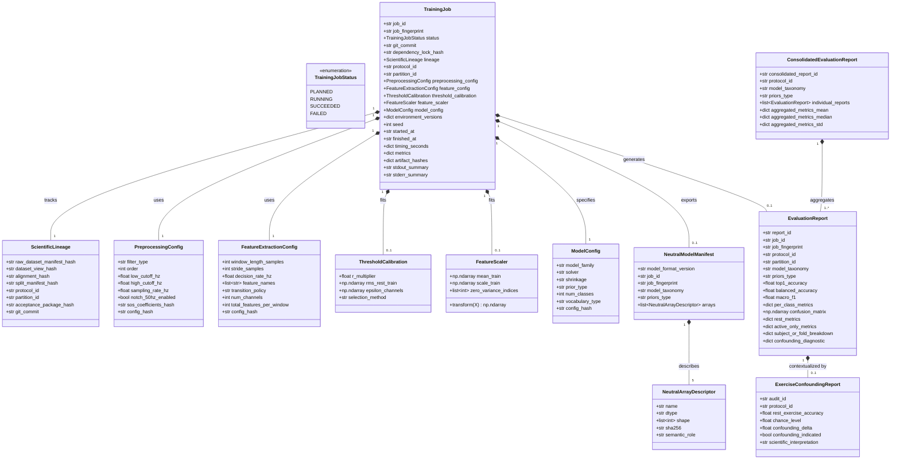

# Phase 1: Data Model — Feature 004

**Feature**: `004-baseline-training-and-evaluation`  
**Status**: Contractually Reconciled  
**Inputs**: Feature Specification (`spec.md`), Research Decisions (`research.md`), Contract Schemas (`contracts/`)

---

## Domain Entities & Relationships



---

## Entity Details & Invariants

### 1. `ScientificLineage`
- **Purpose**: Verifiable cryptographic chain connecting the training execution to frozen Feature 003 artifacts.
- **Fields**:
  - `raw_dataset_manifest_hash`: Hexadecimal SHA-256 of NinaPro DB2 baseline intake inventory.
  - `dataset_view_hash`: Hexadecimal SHA-256 of the active dataset view (`refined`).
  - `alignment_hash`: Cryptographic signature / version of the PROVE-OR-QUARANTINE alignment decision.
  - `split_manifest_hash`: Hexadecimal SHA-256 of the split manifest (`splits_within_subject.json` or `splits_cross_subject.json`).
  - `protocol_id`: `"within_subject"` or `"cross_subject"`.
  - `partition_id`: Identifier of the specific partition (`"S1"`..`"S40"` or `"fold_1"`..`"fold_5"`).
  - `acceptance_package_hash`: Hash of the Feature 003 acceptance manifest (`manifest.sha256`).
  - `git_commit`: Active git commit hash.
- **Invariants**:
  - All hashes must match the frozen Feature 003 acceptance artifacts exactly.
  - No training execution may alter, recompute, or bypass any lineage hash.

---

### 2. `PreprocessingConfig`
- **Purpose**: Immutable specification of the causal signal conditioning pipeline. Validated by [`preprocessing_config_schema.json`](file:///home/allisson/Projects/agents_emg/specs/004-baseline-training-and-evaluation/contracts/preprocessing_config_schema.json).
- **Fields**:
  - `filter_type`: `"butterworth_causal_sos"`.
  - `order`: `4`.
  - `low_cutoff_hz`: `20.0`.
  - `high_cutoff_hz`: `450.0`.
  - `sampling_rate_hz`: `2000.0`.
  - `notch_50hz_enabled`: `False`. Scientific finding: Na amostra auditada de 9 sujeitos cobrindo os 5 folds, não foi observado excesso espectral sistemático em 50 Hz ($R_{50}=0.84$). Com base nessa evidência, o baseline canônico omite notch de 50 Hz.
  - `sos_coefficients_hash`: Hexadecimal SHA-256 digest of the SOS coefficient array.
  - `config_hash`: Hexadecimal SHA-256 of serialized canonical JSON configuration.
- **Invariants**:
  - Preprocessing parameters are owned strictly by Feature 004; no silent inheritance from Feature 002.
  - `notch_50hz_enabled` must remain `False` for the canonical baseline.
  - `additionalProperties: false` enforced.

---

### 3. `FeatureExtractionConfig`
- **Purpose**: Defines temporal segmentation and multi-channel feature extraction.
- **Fields**:
  - `window_length_samples`: `400` ($200\,\text{ms}$ at 2000 Hz).
  - `stride_samples`: `100` ($50\,\text{ms}$ at 2000 Hz, 75% overlap).
  - `decision_rate_hz`: `20.0`.
  - `feature_names`: `["MAV", "RMS", "WL", "ZC", "SSC"]`.
  - `transition_policy`: `"pure_window_steady_state"`.
  - `num_channels`: `12`.
  - `total_features_per_window`: `60` ($12 \times 5$).
  - `config_hash`: Hexadecimal SHA-256 digest of serialized canonical JSON configuration.
- **Invariants**:
  - No window may cross `repetition_unit` or partition boundaries.
  - Transition/mixed windows (REST ↔ ACTIVE, ACTIVE ↔ ACTIVE) are strictly excluded from steady-state datasets.

---

### 4. `ThresholdCalibration`
- **Purpose**: Encapsulates data-driven deadzone thresholds for ZC and SSC.
- **Fields**:
  - `r_multiplier`: Value from candidate grid $\{0.5, 1.0, 1.5, 2.0, 3.0\}$.
  - `rms_rest_train`: Array of shape `(12,)` containing baseline rest RMS per channel computed strictly on TRAIN.
  - `epsilon_channels`: Computed deadzone thresholds: $\epsilon[\text{ch}] = R \times \text{RMS\_rest\_train}[\text{ch}]$.
  - `selection_method`: `"training_pool_validation"`.
- **Invariants**:
  - `rms_rest_train` and `r_multiplier` must NEVER observe validation or test splits.
  - Selected $R$ must be uniform across all 12 channels for a given model fit.

---

### 5. `FeatureScaler`
- **Purpose**: Train-only custom Z-score feature normalization.
- **Fields**:
  - `mean_train`: Array of shape `(60,)` with feature means computed strictly on TRAIN.
  - `scale_train`: Array of shape `(60,)` with feature standard deviations computed strictly on TRAIN.
  - `zero_variance_indices`: List of feature indices where $\sigma_j == 0$, receiving $\text{scale}_j = 1.0$.
- **Invariants**:
  - `sklearn.preprocessing.StandardScaler` is strictly prohibited.
  - Transforming validation and test partitions is strictly stateless: $z = (x - \mu) / \sigma$.

---

### 6. `ModelConfig`
- **Purpose**: Specification of Regularized LDA hyperparameters.
- **Fields**:
  - `model_family`: `"regularized_lda"`.
  - `solver`: `"lsqr"`.
  - `shrinkage`: `"auto"` (Ledoit-Wolf covariance shrinkage, que melhora a estabilidade numérica e o condicionamento da matriz de covariância agrupada).
  - `prior_type`: `"uniform"` ($P(c) = 1/K$, canonical primary) or `"empirical"` ($P(c) = N_c / N_{\text{train}}$, secondary reference).
  - `num_classes`: `50` (primary) or `18` / `24` / `10` (exercise-stratified secondary).
  - `vocabulary_type`: `"global_50_class"`, `"exercise_E1"`, `"exercise_E2"`, or `"exercise_E3"`.
  - `config_hash`: Hexadecimal SHA-256 digest of serialized canonical JSON configuration.
- **Invariants**:
  - Canonical baseline must use `prior_type = "uniform"`.
  - Empirical and uniform priors must be fitted as separate model instances.

---

### 7. `TrainingJob`
- **Purpose**: Immutable, append-only container recording the entire execution lifecycle. Validated by state-aware schema [`training_job_schema.json`](file:///home/allisson/Projects/agents_emg/specs/004-baseline-training-and-evaluation/contracts/training_job_schema.json).
- **State Machine & Lifecycle Invariants**:
  ```mermaid
  stateDiagram-v2
      [*] --> PLANNED: job registered with deterministic fingerprint
      PLANNED --> RUNNING: orchestrator launches execution (records environment & start time)
      RUNNING --> SUCCEEDED: fit complete, neutral export verified, oracle check PASS, all metrics complete
      RUNNING --> FAILED: postcondition failed, timeout, exception, or oracle mismatch (records stderr diagnostics)
      SUCCEEDED --> [*]: job immutable (append-only)
      FAILED --> [*]: failure logged (append-only)
  ```
- **Conditional Contract Validation by State**:
  - **`PLANNED`**: Requires identity (`job_id`, `job_fingerprint`, `status`), provenance (`git_commit`, `dependency_lock_hash`, `lineage`), partition (`protocol_id`, `partition_id`), and configurations (`preprocessing_config`, `feature_config`, `model_config`, `seed`). Metrics, calibrations, and artifact hashes are NOT required.
  - **`RUNNING`**: Requires `PLANNED` fields + execution metadata (`environment_versions`, `started_at`).
  - **`FAILED`**: Requires `PLANNED` fields + execution metadata + diagnostic failure evidence (`stderr_summary`). Final metrics and artifact hashes remain optional.
  - **`SUCCEEDED`**: Requires `PLANNED` fields + execution metadata (`environment_versions`, `threshold_calibration`, `timing_seconds`, `metrics`, `artifact_hashes`, `stdout_summary`).
- **Deterministic Fingerprint Composition**:
  $$\text{job\_fingerprint} = \text{SHA256}(\text{lineage\_hashes} + \text{protocol\_id} + \text{partition\_id} + \text{preprocessing\_config\_hash} + \text{feature\_config\_hash} + \text{model\_config\_hash} + \text{seed} + \text{git\_commit} + \text{dependency\_lock\_hash})$$
  - Volatile fields (timestamps, PID, timing durations, local filesystem paths, logs) are **strictly excluded** from `job_fingerprint`.
- **Invariants**:
  - Completed jobs are append-only; an existing job directory is never overwritten.
  - Every job directory contains sidecar `manifest.sha256` sealing all constituent files.

---

### 8. `NeutralModelManifest` & `NeutralArrayDescriptor`
- **Purpose**: Authoritative contract describing exported pure-numeric parameters for Feature 005. Validated by [`neutral_model_manifest_schema.json`](file:///home/allisson/Projects/agents_emg/specs/004-baseline-training-and-evaluation/contracts/neutral_model_manifest_schema.json).
- **Integrity Policy**: Integrity of `model_manifest.json` is protected via sidecar file `model_manifest.sha256` = SHA-256 of canonical JSON bytes (eliminating self-referential hash fields).
- **Fields**:
  - `model_format_version`: `"1.0.0"`.
  - `job_id`: Associated `TrainingJob` identifier.
  - `job_fingerprint`: Associated deterministic job fingerprint.
  - `model_taxonomy`: `"global_50_class"`, `"exercise_E1"`, `"exercise_E2"`, `"exercise_E3"`.
  - `priors_type`: `"uniform"` or `"empirical"`.
  - `arrays`: Exactly 5 mandatory array descriptors with unique names and roles:
    1. `classes`: shape `(K,)`, dtype `int32`, role `"class_labels"`.
    2. `coef`: shape `(K, 60)`, dtype `float64`, role `"discriminant_coefficients"`.
    3. `intercept`: shape `(K,)`, dtype `float64`, role `"discriminant_intercepts"`.
    4. `mean`: shape `(60,)`, dtype `float64`, role `"scaler_mean"`.
    5. `scale`: shape `(60,)`, dtype `float64`, role `"scaler_scale"`.
- **Invariants**:
  - Zero Python pickle, joblib dumps, or sklearn objects permitted.
  - Descriptors must have exactly 5 elements; duplicate descriptors or missing roles trigger immediate `FAIL`.
  - Binary validation against `model_params.npz` verifies logical array name, dtype, shape, and canonical byte SHA-256 (`array.tobytes()`).

---

### 9. `EvaluationReport` & `ConsolidatedEvaluationReport`
- **Purpose**: Standardized structured evaluation reports with full TrainingJob traceability. Validated by [`evaluation_report_schema.json`](file:///home/allisson/Projects/agents_emg/specs/004-baseline-training-and-evaluation/contracts/evaluation_report_schema.json).
- **Traceability Fields**:
  - `report_id`: Unique report identifier (`report_<protocol>_<partition>_<taxonomy>_<timestamp>`).
  - `job_id`: Identifier of originating `TrainingJob`.
  - `job_fingerprint`: Deterministic fingerprint of originating job.
  - `protocol_id`: `"within_subject"` or `"cross_subject"`.
  - `partition_id`: `"S1"`..`"S40"` or `"fold_1"`..`"fold_5"`.
  - `model_taxonomy`: `"global_50_class"`, `"exercise_E1"`, `"exercise_E2"`, `"exercise_E3"`.
  - `priors_type`: `"uniform"` or `"empirical"`.
- **Metric Fields (all normalized rates bounded strictly to $[0.0, 1.0]$)**:
  - `top1_accuracy`: Float in $[0.0, 1.0]$.
  - `balanced_accuracy`: Float in $[0.0, 1.0]$.
  - `macro_f1`: Float in $[0.0, 1.0]$.
  - `per_class_metrics`: Structured dictionary mapping class label strings (`"0"`..`"49"`) to `{precision, recall, f1, support}`.
  - `confusion_matrix_shape`: Shape array (e.g. `[50, 50]`).
  - `confusion_matrix_hash`: SHA-256 digest of confusion matrix array.
  - `rest_metrics`: `{precision, recall, false_alarm_rate}` (all $[0.0, 1.0]$).
  - `active_only_metrics`: `{top1_accuracy, macro_f1}` strictly over active classes $1..49$ ($[0.0, 1.0]$).
  - `subject_or_fold_breakdown`: Dictionary mapping partition IDs to `{top1_accuracy, balanced_accuracy, macro_f1}`.
  - `confounding_diagnostic`: `{rest_exercise_accuracy, chance_level, confounding_delta, confounding_indicated, interpretation}`.
- **Consolidated Reports Policy**:
  - An individual `EvaluationReport` documents a single partition/job run.
  - `ConsolidatedEvaluationReport` is a composition aggregating all 40 Within-Subject or all 5 Cross-Subject individual reports, producing global summary statistics (mean, median, standard deviation).
- **Invariants**:
  - Averaging E1, E2, E3 to replace global metrics is strictly prohibited.
  - Secondary models and diagnostic audits are segregated from primary benchmark reporting.

---

### 10. `ExerciseConfoundingReport`
- **Purpose**: Diagnostics evaluating recording/session bias in baseline rest.
- **Fields**:
  - `audit_id`: Identifier.
  - `protocol_id`: `"within_subject"` or `"cross_subject"`.
  - `rest_exercise_accuracy`: Accuracy in predicting exercise $\{E1, E2, E3\}$ strictly from REST windows.
  - `chance_level`: `0.3333333333333333` ($1/3$).
  - `confounding_delta`: $\text{rest\_exercise\_accuracy} - \text{chance\_level}$.
  - `confounding_indicated`: Boolean flag (`True` if $\text{confounding\_delta} > 0.05$).
  - `scientific_interpretation`: Standardized interpretation string:
    - If near chance: `"nenhuma evidência de confounding detectável por este diagnóstico"`.
    - If substantially above chance: `"evidência de confounding de sessão/exercício detectada; deve acompanhar explicitamente a interpretação dos resultados globais"`.

---

## Numerical Tolerance Registry

| Tolerance ID | Target / Quantity | Dtype | Rationale | rtol | atol | Oracle / Reference | Status |
| :--- | :--- | :--- | :--- | :--- | :--- | :--- | :--- |
| `TOL-LDA-NEUTRAL-SCORES` | Decision function score difference between `LinearDiscriminantAnalysis.decision_function(X)` and `NeutralNumpyPredictor.decision_scores(X)` | `float64` | Floating-point accumulation differences between BLAS DGEMM and Scikit-learn internal evaluation of $X @ W^T + b$ | `1e-9` | `1e-7` | Scikit-learn LDA | `ACTIVE` |
| `TOL-LDA-PREDICTED-CLASS` | Predicted class agreement between Scikit-learn and Neutral NumPy | `int32` | Discrete argmax decision agreement | `0.0` | `0.0` (Exact Match, 0 errors) | Scikit-learn LDA | `ACTIVE` |
| `TOL-TIME-DOMAIN-FEATURES` | Analytical feature extraction verification (MAV, RMS, WL, ZC, SSC) | `float64` | Analytical mathematical equality on synthetic test signals | `1e-12` | `1e-12` | Closed-form analytical formula | `ACTIVE` |
| `TOL-FEATURE-SCALING` | Train-only custom Z-score normalization | `float64` | Standard floating-point precision of $(x - \mu) / \sigma$ | `1e-12` | `1e-12` | NumPy reference calculation | `ACTIVE` |
